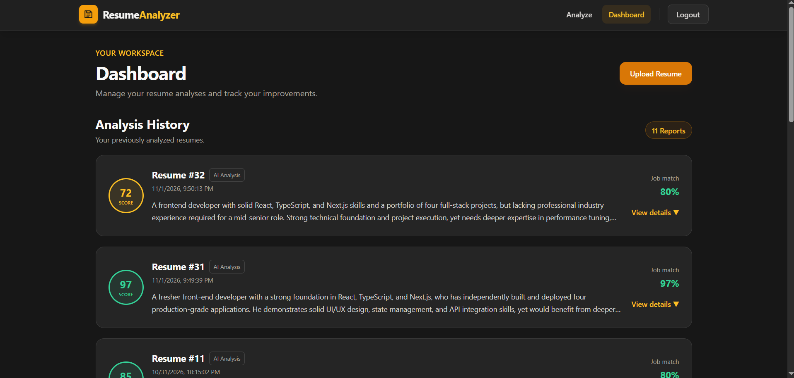
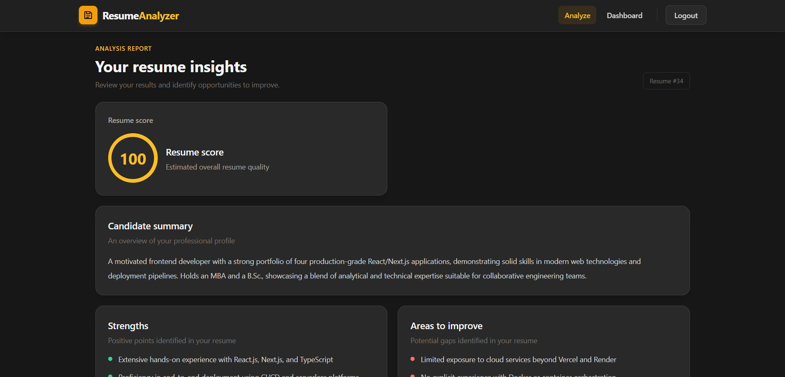
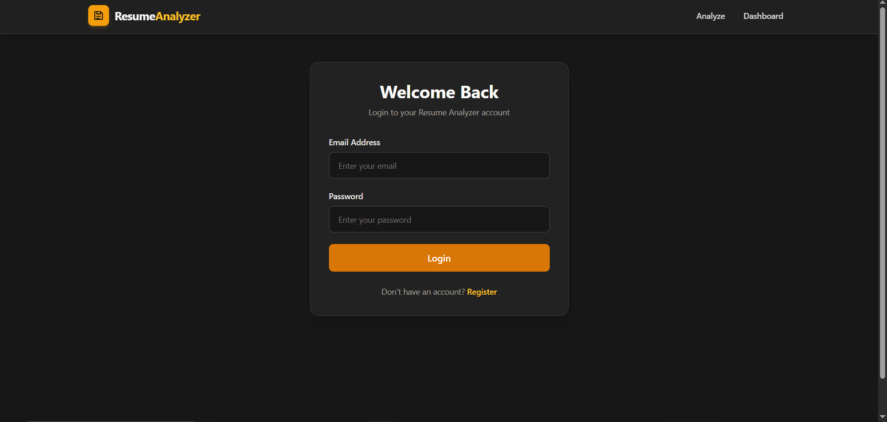
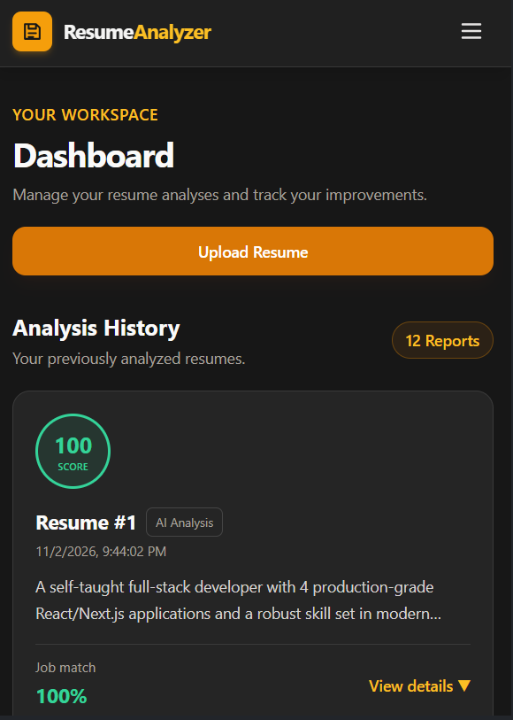

# AI Resume Analyzer

An AI-powered resume analysis web application that helps users review their resumes, identify strengths and skill gaps, and evaluate how well a resume matches a target job description.

The application includes user authentication, PDF/DOCX resume uploads, AI-generated feedback, and a personal dashboard that keeps previous analysis reports.

## Screenshots

### Dashboard — Desktop


### Resume Analyzer — Desktop


### Login — Desktop


### Dashboard — Mobile


## Features

- **User authentication:** Register, log in, and access protected pages using JWT authentication.
- **Resume upload:** Upload resumes in PDF or DOCX format.
- **AI-powered analysis:** Get an overall resume score, summary, strengths, weaknesses, missing skills, and improvement suggestions.
- **Job description matching:** Optionally provide a job description to receive a job match score and keyword insights.
- **Analysis history:** View previous reports from a personal dashboard.
- **Expandable reports:** Open a report to review its detailed feedback.
- **Responsive interface:** Dark UI with an amber accent theme, designed for desktop and mobile screens.
- **Protected user data:** Resume history is associated with the authenticated user.

## Tech Stack

| Area | Technologies |
|---|---|
| Frontend | React, TypeScript, Vite, Tailwind CSS |
| Backend | Node.js, Express.js, TypeScript |
| Database | PostgreSQL |
| Authentication | JSON Web Tokens (JWT), bcrypt |
| AI integration | Groq API |
| Resume parsing | pdf-parse, Mammoth |
| HTTP client | Axios |

## Project Structure

```text
ai-resume-analyzer/
├── client/
│   ├── public/
│   └── src/
│       ├── assets/
│       ├── components/
│       │   ├── Navbar.tsx
│       │   └── ProtectedRoute.tsx
│       ├── config/
│       │   └── api.ts
│       ├── hooks/
│       │   └── useLocalStorage.ts
│       ├── pages/
│       │   ├── Dashboard.tsx
│       │   ├── Login.tsx
│       │   ├── Register.tsx
│       │   └── ResumeAnalyzer.tsx
│       ├── App.tsx
│       ├── App.css
│       ├── index.css
│       └── main.tsx
├── server/
│   ├── src/
│   │   ├── ai/
│   │   │   └── analyzeResume.ts
│   │   ├── config/
│   │   │   └── db.ts
│   │   ├── middleware/
│   │   │   └── authMiddleware.ts
│   │   ├── models/
│   │   │   └── userModel.ts
│   │   └── routes/
│   │       ├── authRoutes.ts
│   │       └── resumes.ts
│   ├── uploads/
│   ├── index.ts
│   └── package.json
└── README.md
```

## Getting Started

### Prerequisites

- Node.js and npm
- PostgreSQL
- A Groq API key

### 1. Clone the repository

```bash
git clone https://github.com/nandakishorebuild/AI-Resume-Analyzer.git
cd AI-Resume-Analyzer
```

### 2. Install dependencies

Install frontend and backend dependencies separately:

```bash
cd server
npm install

cd ../client
npm install
```

### 3. Configure environment variables

Create a `.env` file in the **server** directory:

```env
PORT=5000
CLIENT_URL=http://localhost:5173

DB_USER=your_postgres_username
DB_HOST=localhost
DB_NAME=your_database_name
DB_PASSWORD=your_postgres_password
DB_PORT=5432

JWT_SECRET=replace_with_a_long_random_secret
GROQ_API_KEY=your_groq_api_key
```

Create a `.env` file in the **client** directory:

```env
VITE_API_URL=http://localhost:5000
```

**Important:** Never commit real `.env` files, API keys, database passwords, JWT secrets, or uploaded resumes to GitHub. Use environment variables in your deployment platform.

### 4. Set up PostgreSQL

Create a PostgreSQL database and configure the database connection values in `server/.env`.

The application expects the `users` and `resumes` tables used by the backend models and routes. Make sure those tables are created with the columns referenced by the SQL queries in the project before starting the server.

### 5. Run the application

Open two terminals from the project root.

**Terminal 1 — Backend**

```bash
cd server
npm run dev
```

The backend uses port `5000` by default.

**Terminal 2 — Frontend**

```bash
cd client
npm run dev
```

Vite typically serves the frontend at `http://localhost:5173`.

If your package scripts use different names, use the scripts defined in the respective `package.json` files.

## How It Works

1. A user registers or logs in.
2. The backend verifies credentials and issues a JWT.
3. The frontend sends the JWT in the `Authorization: Bearer <token>` header for protected API requests.
4. The user uploads a PDF or DOCX resume and can optionally provide a job description.
5. The backend extracts text from the uploaded document.
6. The extracted resume text and optional job description are sent to the Groq-powered analysis function.
7. The analysis result is stored in PostgreSQL and returned to the frontend.
8. The dashboard retrieves the user's previous reports and displays their scores and detailed feedback.

## Analysis Output

Depending on whether a job description is supplied, the report can include:

- Overall resume score
- Job match score
- Resume summary
- Strengths
- Weaknesses / areas to improve
- Missing skills
- Matched and missing keywords
- Suggestions for improvement

AI-generated scores and suggestions are estimates. They should be used as guidance and not treated as a guarantee of ATS results or hiring outcomes.

## API Overview

| Method | Endpoint | Purpose |
|---|---|---|
| POST | `/api/auth/register` | Register a new user |
| POST | `/api/auth/login` | Log in and receive a JWT |
| GET | `/api/auth/me` | Verify the authenticated user |
| POST | `/api/resumes/upload` | Upload and analyze a resume |
| GET | `/api/resumes/history` | Retrieve the authenticated user's analysis history |
| GET | `/api/resumes/analyze/:id` | Retrieve a saved analysis |

Protected routes require a valid JWT in the Authorization header.

## Security Notes

- Passwords are hashed before being stored.
- Protected API routes verify JWTs.
- Database queries use parameterized values.
- Resume records are checked against the authenticated user's ID.
- Uploads are restricted to PDF and DOCX files with a configured size limit.
- Secrets and environment files should remain outside version control.

## Future Improvements

- Add downloadable analysis reports.
- Add resume improvement suggestions with examples.
- Add more detailed ATS-focused checks.
- Add deployment monitoring and automated tests.

## Author

**Nanda Kishore**

- GitHub: [@nandakishorebuild](https://github.com/nandakishorebuild)
- LinkedIn: [nandakishore3960](https://www.linkedin.com/in/nandakishore3960)

---

If you find this project useful, feel free to explore the repository and share feedback.
